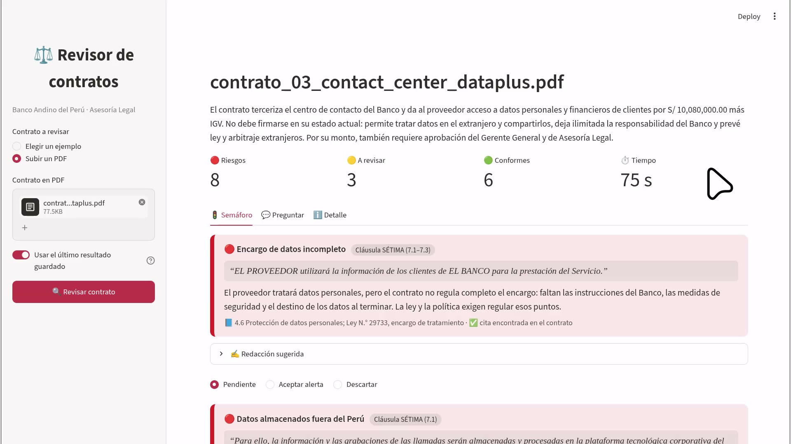
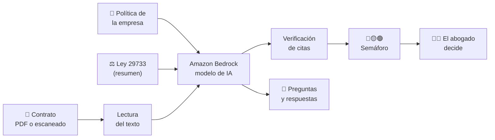

# ⚖️ Revisor inteligente de contratos

Prototipo que hace la **primera revisión de un contrato** con IA generativa en la nube. Lo compara con la política de la empresa y con la normativa peruana, y entrega un **semáforo 🔴🟡🟢** donde cada alerta cita la frase exacta y propone una nueva redacción.

**La IA señala; el abogado decide.**

  

🎥 [Ver el video de la demo](video/demo.mp4) (usa un análisis guardado)



> El banco, los proveedores, las personas y los contratos son **ficticios**. El resultado no reemplaza la revisión de un abogado.

## Contenido

- [El problema](#el-problema)
- [Qué hace](#qué-hace)
- [Cómo funciona](#cómo-funciona)
- [Resultados](#resultados)
- [Instalación y uso](#instalación-y-uso)
- [Estructura del repositorio](#estructura-del-repositorio)
- [Del prototipo a producción](#del-prototipo-a-producción)
- [Limitaciones](#limitaciones)

## El problema

Revisar contratos a mano es lento y repetitivo: hay que leerlos completos para encontrar los pocos puntos que de verdad importan. Una sola cláusula que se escape, como un plazo de pago excesivo, una penalidad o datos de clientes guardados fuera del país, puede salir muy cara.

## Qué hace

- **Lee contratos en PDF** digitales. La lectura de escaneados está implementada, pero aún no se ha probado con el modelo.
- **Los compara** con la política de contratación y con un resumen de la Ley 29733 de Protección de Datos Personales.
- **Clasifica** los hallazgos: 🔴 riesgo, 🟡 por revisar y 🟢 conforme.
- **Justifica cada alerta** con la cláusula, la cita literal, la regla y una redacción sugerida.
- **Verifica cada cita** automáticamente contra el texto del contrato.
- **Responde preguntas** sobre el contrato abierto.
- **Deja la decisión a la persona**: cada alerta se acepta o se descarta.

## Cómo funciona



El modelo se llama con la **Converse API** de Amazon Bedrock, así que se puede cambiar con una variable de entorno, sin tocar el código. Los PDF digitales se leen localmente; en los escaneados, el modelo lee las páginas como imágenes.

## Resultados

Evaluación con 3 contratos de prueba y 10 riesgos plantados, contra una [hoja de respuestas](documentos/respuestas_esperadas.json):

| Métrica | Resultado |
|---|---|
| Riesgos detectados | **10 de 10** |
| Riesgos con el color correcto | **10 de 10** |
| Citas que existen tal cual en el contrato | **21 de 21** |
| Alertas adicionales a los riesgos plantados | **6 de 21** |
| Costo estimado por contrato | **≈ US$ 0,26** |
| Tiempo por contrato | **65 s a 7 min** |

De las 6 alertas adicionales, 4 aparecieron en el contrato sin problemas plantados, por encima de la meta de 2: el revisor tiende a ser **más estricto de lo necesario**. El costo usa como referencia el precio de lista de un modelo equivalente en Bedrock.

Para repetir la evaluación gratis, con los análisis guardados:

```bash
python scripts/evaluar.py
```

## Instalación y uso

**Requisitos:** Python (probado con 3.14). Para análisis nuevos o preguntas, también AWS CLI y una cuenta de AWS con permiso para invocar modelos en Amazon Bedrock.

```bash
git clone https://github.com/Pierorivera1/revisor-contratos-ia.git
cd revisor-contratos-ia
python -m venv .venv
source .venv/bin/activate        # Windows: .venv\Scripts\activate
pip install -r requirements.txt
streamlit run app/app.py
```

**Sin cuenta de AWS:** elige un ejemplo, activa *Usar el último resultado guardado* y presiona **Revisar contrato**.

**Con AWS:** inicia sesión antes de abrir la app.

```bash
aws login
```

> ⚠️ Cada análisis nuevo y cada pregunta consumen tokens de Bedrock y **tienen costo**.

| Variable | Uso | Valor por defecto |
|---|---|---|
| `AWS_REGION` | Región de Bedrock | `us-east-1` |
| `MODELO_ID` | Modelo o perfil de inferencia | `us.moonshotai.kimi-k3.1` |

## Estructura del repositorio

```text
├── app/             Aplicación y lógica del revisor
├── docs/            Imagen del README
├── documentos/      Contratos de prueba, política, normativa y hoja de respuestas
├── resultados/      Análisis guardados y evaluación
├── scripts/         Evaluación y generación de documentos de prueba
└── video/           Video de la demo
```

## Del prototipo a producción

Lo siguiente es una **propuesta**: hoy el prototipo corre localmente y usa Amazon Bedrock.

| Necesidad | AWS | Equivalente en Microsoft |
|---|---|---|
| Modelo de IA | Amazon Bedrock ✅ *en el prototipo* | Microsoft Foundry |
| Lectura de escaneados a gran volumen | Amazon Textract | Document Intelligence |
| Preguntas sobre todos los documentos (RAG) | Bedrock Knowledge Bases + S3 Vectors | Azure AI Search |
| Filtros y protección de datos | Bedrock Guardrails | AI Content Safety |
| Coordinación del flujo | AWS Lambda | Azure Functions |
| Documentos | Amazon S3 | SharePoint |
| Uso diario | AWS Amplify + Amazon Cognito | Copilot Studio en Teams o Word |

### Siguiente paso: chatbot con RAG

Permitiría preguntarle a todos los contratos, políticas y leyes, con respuestas que citan su fuente.


## Limitaciones

- La evaluación es pequeña y usa contratos creados para la prueba; falta un piloto con contratos reales y abogados.
- Aún no se mide la consistencia entre varios análisis de un mismo contrato.
- La lectura de contratos escaneados no se ha probado con el modelo ni forma parte de la evaluación.
- El modelo puede equivocarse o ser influido por texto malicioso dentro de un contrato: toda alerta debe revisarla una persona.
- El contrato se envía completo a Amazon Bedrock y los análisis se guardan sin cifrar en `resultados/`. No uses contratos confidenciales reales sin agregar controles.
- El prototipo no incluye usuarios, roles ni registro de auditoría.

---

Desarrollado por [Piero Rivera](https://github.com/Pierorivera1).
